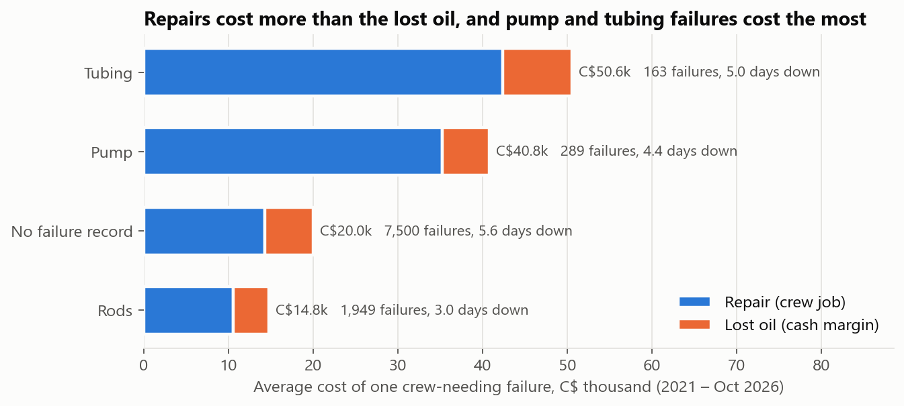
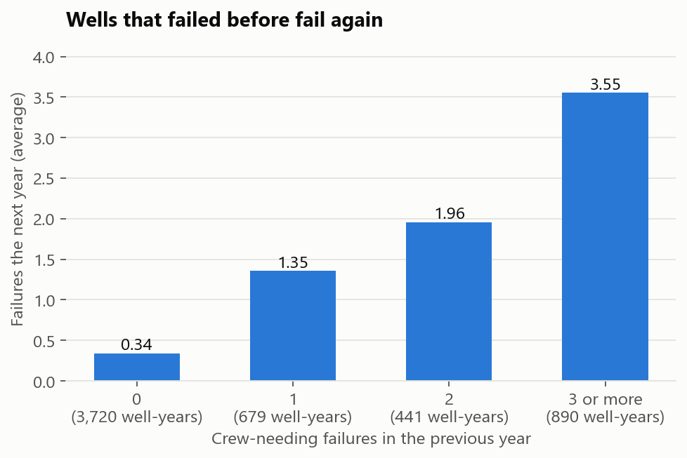
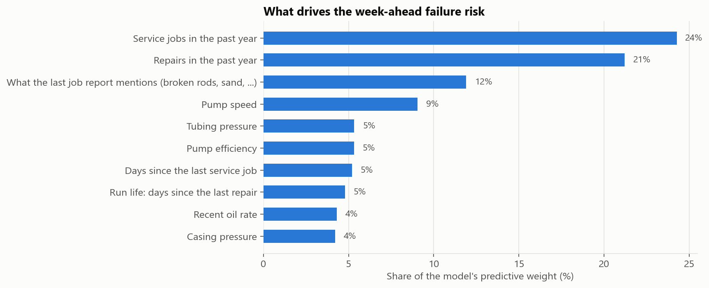
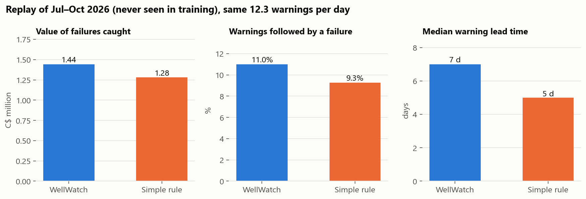
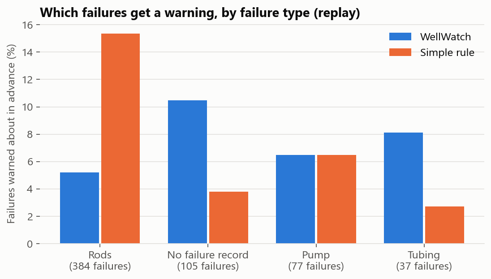
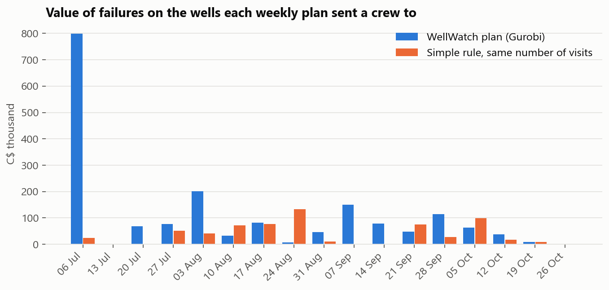
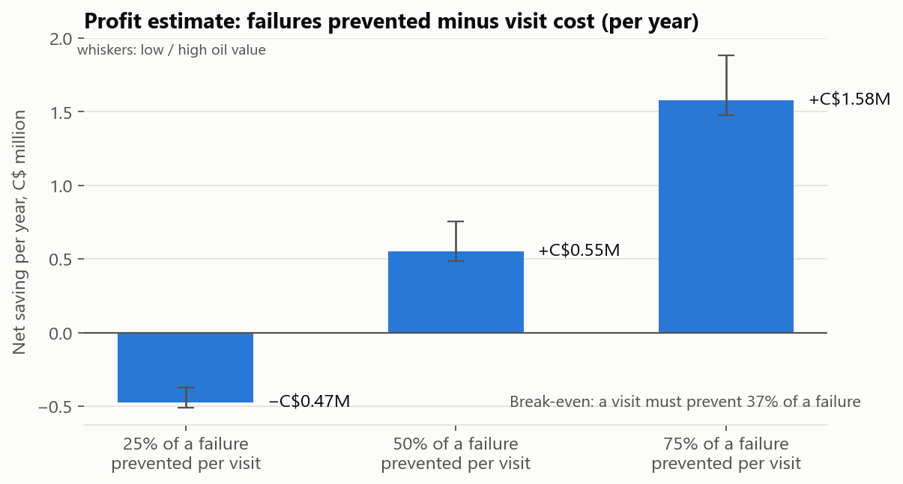

# WellWatch results

**Goal:** reduce downtime and production losses on Strathcona's heavy-oil wells by warning a week ahead
of crew-needing equipment failures and planning crew visits to minimise the expected total loss.

Every number below comes from `python -m wellwatch.analysis` (tables in `docs/results/`, charts in
`docs/figures/`), the replay scoreboard and the weekly crew plans. Money is in Canadian dollars.
Lost oil is valued per quarter from Strathcona/Cenovus public reports
(`data/external/oil_prices_quarterly.csv`). The **base** case is the cash margin lost (price minus
royalties, transport and energy cost); **low** is the field netback and **high** is the full revenue.

## 1. The problem in numbers (2021 – Oct 2026, 1,990 oil wells)

| | Value |
|---|---|
| Crew-needing failures* | 9,903, about **1,700 a year** |
| Downtime from these failures | 1.20 million well-hours: 39% of all equipment-failure downtime |
| Oil lost during these failures | 149,000 m³ (about 25,600 m³ a year) |
| Cost per year (repairs + lost oil, base) | **C$34.2M** (C$24.9M repairs + C$9.3M lost oil) |
| Average failure | 5.0 days down, 15 m³ oil lost, C$14.6k repair + C$5.4k oil |

\*An equipment-failure downtime episode followed within a week by a Rod Truck or Workover job.

**Repair cost vs lost revenue.** Repairs are the larger part of a failure's cost. Lost oil is 27% of the
cost in the base case, 23% at the low value and 36% even at full revenue. Pump and tubing failures are
rarer than rod failures but cost 3–4 times as much (Figure 1).

| Failure type (recorded) | Failures | Days down | Repair | Lost oil (base) | Total |
|---|---|---|---|---|---|
| Tubing | 163 | 5.0 | C$42.4k | C$8.2k | C$50.6k |
| Pump | 289 | 4.4 | C$35.3k | C$5.5k | C$40.8k |
| Rods | 1,949 | 3.0 | C$10.5k | C$4.2k | C$14.8k |
| No failure record | 7,500 | 5.6 | C$14.3k | C$5.7k | C$20.0k |

Only 24% of crew-needing failures can be matched to a record in the failures file (2,873 records), so
the breakdown by type covers the recorded failures. Fatigue and corrosion are the most common
recorded causes (`docs/results/failure_cost_by_cause.csv`).



## 2. What drives failures

**Wells that failed before fail again.** A well with no crew-needing failure last year averages 0.34
the next year, and 17% have one. A well with three or more averages **3.55**, and 85% fail again
(Figure 2). This is the single strongest signal.



The model's strongest inputs (share of its predictive weight, Figure 3):

1. Service jobs in the past year (24%)
2. Repairs in the past year (21%)
3. What the last job report mentions: broken rods, sand, stator/rotor (12%)
4. Pump speed (9%)
5. Tubing pressure, pump efficiency, days since the last service job, run life since the last repair
   (about 5% each)

Sensor trends (efficiency, pressures, oil rate) add to the history signals but do not replace them.



## 3. Week-ahead warnings

**Model:** XGBoost, calibrated. It predicts whether a running well has a crew-needing failure in the
next 7 days, using only data from before the day. It was trained on 2021–2024, calibrated on the first
half of 2025, and tested on Jul 2025 – Jun 2026.

| Test year | ROC-AUC | Top 15 wells a day: share that fail within 7 days |
|---|---|---|
| **WellWatch model** | **0.745** | **15.4%** (4.2× the 3.7% base rate) |
| Well's historical failure rate | 0.653 | 12.8% |
| Shortest run life since last repair | 0.679 | 10.1% |
| Equipment downtime in the last 30 days | 0.575 | 3.9% |

**Replay through Canary (Jul – Oct 2026, never used for training).** Each day's data was written to
Canary, read back, scored and turned into alerts as if live. Both approaches give the same 12.3 warnings
a day (Figure 4):

| 603 crew-needing failures | WellWatch | Simple rule (shortest run life) |
|---|---|---|
| Value of failures warned about | **C$1.44M** | C$1.28M |
| Warnings followed by a failure | **11.0%** | 9.3% |
| Median warning lead time | **7 days** | 5 days |
| Failures warned about | 39 (6.5%) | **69 (11.4%)** |

The model ranks warnings by **expected loss** (risk × cost of a failure at that well), so it focuses on
costly wells. That is why it catches more value but fewer failures. Ranking the same model by risk
alone catches 66 failures with 15.1% of warnings correct, but less value (C$1.17M). This is a choice
for the operator.



By failure type (Figure 5), WellWatch warns about more pump, tubing and unrecorded failures. The simple
rule warns about more rod failures, which are frequent but cheap. By field, the model's warnings
concentrate on Druid Main and Cosine and it never warned in Cactus Lake (172 failures) or Court
(53), where the expected cost per failure is lower (`docs/results/replay_catch_by_field.csv`).



## 4. Crew planning with Gurobi

Each Monday a mixed-integer program chooses which at-risk wells each field crew visits over the next
7 days. It **minimises expected failure loss plus visit cost**, within crew hours per day (5.5-hour
jobs plus travel), a weekly budget, crew zones and critical wells visited by day 2. It solves in under
1.5 seconds.

17 weekly plans over the replay (326 visits, C$489k of visits at an assumed C$1,500 per inspection):

| | WellWatch plan | Simple rule, same number of visits |
|---|---|---|
| Planned wells that failed within 7 days | 36 (11.0%) | 29 (8.9%) |
| Value of those failures | **C$1.81M** | C$0.63M |
| …of which the crew visited before the failure | C$1.34M | – |

The planner's own forecast: expected loss falls from C$4.89M to C$4.72M, a **net C$167k after visit
costs (about C$0.51M a year)**.



## 5. Profit estimate

Net saving = (share of a failure a visit prevents) × (value of failures visited in time) − visit cost,
scaled from 17 weeks to a year. The share a visit prevents is **not in the data**, so we show a range
(Figure 7):

| A visit prevents… | Net saving per year (base) | Low – high oil value |
|---|---|---|
| 25% of a failure | −C$0.47M | −C$0.51M to −C$0.37M |
| **50% of a failure** | **+C$0.55M** | +C$0.48M to +C$0.75M |
| 75% of a failure | +C$1.58M | +C$1.48M to +C$1.88M |

**Break-even:** a visit must prevent 37% of a failure.

**How solid is this?** The four months are lumpy. One week (6 July) holds C$430k of the C$1.34M visited
in time. Without that week the break-even rises to 51%, and the 50% case is about break-even (−C$0.04M
a year), while 75% still gives +C$0.70M. Even without it, the planned wells carried far more failure
value than the simple rule's (C$1.01M vs C$0.61M), so the targeting holds up. The planner's
expected-loss forecast stays at about +C$0.52M a year either way.

For scale: crew-needing failures cost about **C$34M a year**. The plan works on the wells most likely to
fail in a given week, so the saving is about 1.5% (50% effective) to 4.5% (75% effective) of that.
It grows with visit effectiveness and with more crews (the app reports the value of one more crew per
field).



## 6. Recommendations

1. **Run WellWatch daily on Canary** (as built): risk, expected loss, alert level and reasons for every
   running well, with a Canary event when a well reaches warning level.
2. **Plan crews weekly with the Gurobi planner** and send the plan to Canary (`PlannedVisitDay`,
   `PlannedCrew`).
3. **Track what visits achieve.** Record the outcome of each proactive visit. That turns the
   effectiveness assumption, which decides whether the plan pays, into a measured number.
4. **Watch repeat failers.** Wells with 3+ failures last year fail again 85% of the time; they deserve
   a root-cause review (rod design, corrosion treatment), not just repeat repairs.
5. **Close the gaps:** add a per-field minimum so fields like Cactus Lake still get warnings, and
   combine the model with the run-life rule for rod failures, where the rule does better.
6. **Improve the records.** Three quarters of crew-needing failures have no failure record, which limits
   the analysis by failure type.

## 7. Assumptions and limits

- **Visit effects:** visit effectiveness (default 50%) and inspection cost (C$1,500) are assumptions;
  proactive Rod Truck visits use the recorded average (5.5 h, about C$2.7k).
- **Repair cost** is the jobs' field estimate (`field_est_total`), summed over the Rod Truck / Workover
  jobs linked to each failure.
- **Lost oil** is the `lost_oil_m3` recorded during the downtime episode, valued per quarter.
- **Replay window:** the replay covers four months (603 failures). The yearly figures scale that window
  up and do not account for seasons.
- **Crews:** the number of crews per field comes from the most crews seen working at once in the
  records (90th percentile).

## Reproduce

```
python -m wellwatch.train                                    # model (models/)
python -m wellwatch.engine replay --start 2026-07-01 --end 2026-10-26 --seconds-per-day 0 --fresh
python -m wellwatch.scoreboard                               # replay scoreboard
python -m wellwatch.plan --weekly 2026-07-06 2026-10-26      # weekly crew plans
python -m wellwatch.analysis                                 # tables and charts in docs/
```
